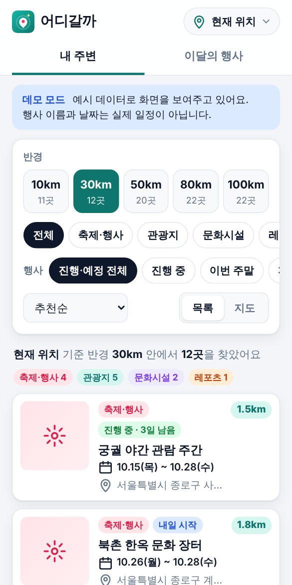
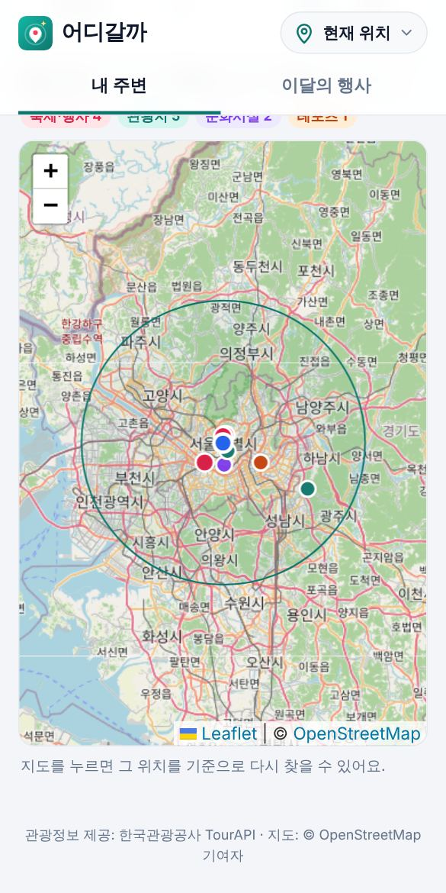
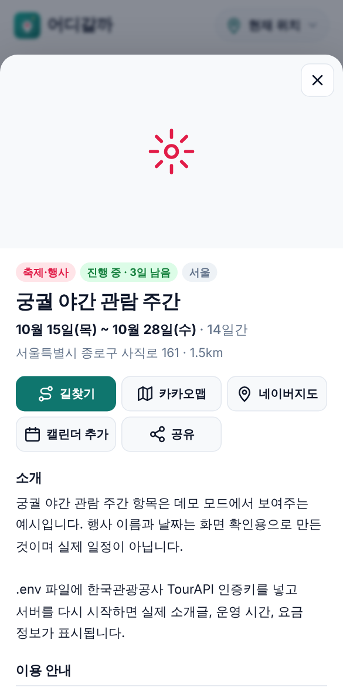
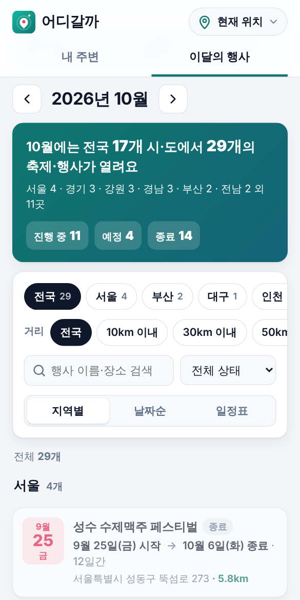
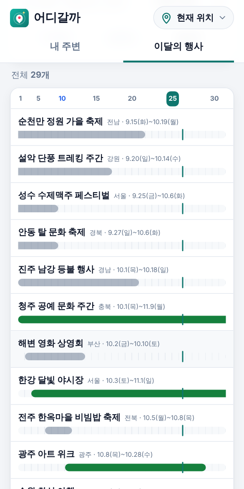

# 어디갈까 · 내 주변 관광지·축제 앱

내 위치를 기준으로 **반경 10km · 30km · 50km · 80km · 100km** 안의 관광지와 축제·행사를 찾아 주고,
**전국 축제·행사를 월별로** "어디에서, 무엇이, 언제 시작해서 언제 끝나는지" 보여 주는 앱입니다.

데이터는 [한국관광공사 TourAPI 4.0](https://www.data.go.kr/data/15101578/openapi.do)(공공데이터포털, 무료)을 사용합니다.
휴대폰에서 홈 화면에 추가해 앱처럼 쓸 수 있는 웹앱(PWA)입니다.

| 내 주변 (반경별) | 지도 | 상세 정보 | 이달의 행사 | 일정표 |
| --- | --- | --- | --- | --- |
|  |  |  |  |  |

> 스크린샷은 데모 모드(예시 데이터)입니다.

## 주요 기능

### 내 주변
- 현재 위치(GPS) 또는 도시 선택, 지도에서 직접 고른 위치를 기준으로 검색
- 반경 **10 / 30 / 50 / 80 / 100km** 버튼마다 몇 곳이 있는지 개수 표시
- 분류: 전체 · 축제·행사 · 관광지 · 문화시설 · 레포츠
- 행사 기간: 진행·예정 전체 · 진행 중 · 이번 주말 · 30일 이내
- 정렬: 추천순(가깝고, 진행 중이거나 곧 열리고, 사진이 있는 곳 우선) · 가까운 순 · 행사 날짜순
- 목록 / 지도 보기 (지도에 반경 원과 분류별 색상 마커)

### 이달의 행사 (전국)
- 상단 요약: "10월에는 전국 17개 시·도에서 132개의 축제·행사가 열려요" + 시·도별 개수 + 진행 중/예정/종료 개수
- 지난달·다음달 이동
- 필터: 시·도, 내 위치에서 거리(10~100km), 진행 상태, 이름·장소 검색
- 보기 3가지
  - **지역별**: 시·도별로 묶어서 "10월 3일(토) 시작 → 10월 12일(월) 종료 · 10일간"
  - **날짜순**: 시작일별로 묶어서 (지난달부터 이어지는 행사는 맨 위)
  - **일정표**: 한 달 달력 위에 행사 기간을 막대로 표시, 오늘 위치 표시

### 주변 맛집 · 추천 카페
- 맛집 / 카페를 고르고 반경 **1km · 3km · 5km · 10km** 안에서 찾기
- 데이터는 [한끼 최저가](https://github.com/kts4u1/Restaurant) 앱과 같은 방식으로 모읍니다:
  카카오 로컬 API로 주변 가게를 찾고, 카카오맵 장소 정보에서 **평점·리뷰 수·블로그 리뷰 수·"맛" 추천 수·영업시간·메뉴**를 가져옴
- 맛집 점수도 한끼 최저가와 같은 공식(리뷰가 적은 곳의 높은 평점은 평균 쪽으로 보정)이고, 평점이 좋은 곳만 맛집순으로 보여 줌.
  리뷰 10개 이상에 점수가 높으면 **맛집** / **인기 카페** 표시
- 관광객용이라 **최저가 계산은 빼고**, 구내식당·기사식당·한식뷔페·도시락·패스트푸드·술집도 뺌. 카페는 프랜차이즈 커피점을 뺌
- "평점 낮은 곳도 보기"를 켜면 전부 보임
- **카카오 API 를 검색할 때마다 부르지 않음**: 지역(반경별 약 400m~4km 격자 칸)마다 받아 둔 가게 목록과 평점을
  Cloudflare 저장소(Workers KV)에 보관하고, **12시간이 지났을 때만**(하루 최대 두 번) 새로 받음.
  같은 칸에서 검색하는 다른 사람도 저장된 데이터를 바로 받고, 카카오가 잠시 안 되면 이전 데이터를 보여 줌.
  처음 검색되는 지역만 평점을 8곳씩 나눠 받느라 몇 초 걸림. 화면에 "카카오맵 데이터 기준: 오늘 09:34"처럼 받은 시각 표시

### 상세 정보
- 사진, 기간, 주소, 거리, 소개글, 이용 안내(장소·시간·요금·주최 등), 홈페이지
- 카카오맵 길찾기 · 카카오맵 · 네이버지도 · 구글 캘린더에 추가 · 전화 · 공유

## 빠른 시작

Node.js 20.12 이상이 필요합니다.

```bash
npm install
npm start
```

브라우저에서 http://localhost:3000 을 엽니다.
인증키가 없으면 **데모 모드**(예시 데이터)로 실행되어 화면을 바로 확인할 수 있습니다.
데모 모드의 행사 이름과 날짜는 화면 확인용 예시이며 실제 일정이 아닙니다.

## 실제 데이터 연결 (TourAPI 인증키)

1. [공공데이터포털](https://www.data.go.kr) 회원가입 후 로그인
2. [한국관광공사_국문 관광정보 서비스_GW](https://www.data.go.kr/data/15101578/openapi.do) 페이지에서 **활용신청** (보통 자동 승인)
3. 마이페이지 › 데이터활용 › Open API › 활용신청 현황에서 **일반 인증키** 복사
4. 프로젝트 폴더에서 `.env.example` 을 `.env` 로 복사하고 키를 넣기
   ```
   TOUR_API_KEY=발급받은_인증키
   ```
   Encoding 키와 Decoding 키 중 어느 것을 넣어도 됩니다.
5. `npm start` 로 다시 실행

처음 실행하면 전국 관광지·문화시설·레포츠 목록을 내려받습니다(1~2분). 받은 목록은 `data/cache/` 에 저장되어 3일 동안 다시 받지 않습니다.
발급 직후에는 키가 반영되기까지 1~2시간 걸릴 수 있습니다.
개발계정은 하루 호출 수에 제한이 있으니, 서비스를 공개하기 전에 공공데이터포털에서 운영계정 전환을 신청하세요.

## Cloudflare 에 배포하기

GitHub 에 push 하면 GitHub Actions 가 자동으로 Cloudflare Workers 에 배포합니다. 무료 플랜으로 충분합니다.

### 처음 한 번만 하는 설정

1. **Cloudflare 계정 ID 확인**: [Cloudflare 대시보드](https://dash.cloudflare.com) 로그인 › 왼쪽 메뉴 **Workers 및 Pages** › 오른쪽에 보이는 **계정 ID** 복사
   (또는 대시보드 주소 `dash.cloudflare.com/` 뒤의 32자리 값)
2. **API 토큰 만들기**: 오른쪽 위 프로필 › **내 프로필** › **API 토큰** › **토큰 생성** › **Cloudflare Workers 편집(Edit Cloudflare Workers)** 템플릿 **사용** › 계정 리소스에서 내 계정 선택 › **요약으로 계속** › **토큰 생성** › 토큰 복사 (한 번만 보여 줌)
3. **GitHub Secrets 등록**: 저장소 **Settings › Secrets and variables › Actions › New repository secret** 에서 3개 등록

   | Name | 값 |
   | --- | --- |
   | `TOUR_API_KEY` | 공공데이터포털 TourAPI 인증키 |
   | `CLOUDFLARE_API_TOKEN` | 2번에서 만든 API 토큰 |
   | `CLOUDFLARE_ACCOUNT_ID` | 1번의 계정 ID |
   | `KAKAO_REST_API_KEY` | (선택) 카카오 REST API 키 — 주변 맛집 탭용. 한끼 최저가에 넣은 키와 같은 것. 없으면 예시 맛집이 나옴 |

4. **배포 실행**: 저장소 **Actions** 탭 › **Cloudflare 배포** › **Run workflow** (또는 기본 브랜치에 push)
5. 배포가 끝나면 `https://tour-nearby.<내-서브도메인>.workers.dev` 주소로 접속합니다.
   주소는 Actions 실행 기록의 "Cloudflare 에 배포" 단계 로그나 Cloudflare 대시보드 › Workers 및 Pages › tour-nearby 에서 볼 수 있습니다.
   처음 Workers 를 쓰는 계정이면 대시보드에서 workers.dev 서브도메인을 먼저 정하라고 나올 수 있습니다.

그 뒤로는 **매일 새벽 3시 41분(한국 시간)** 에 최신 행사 데이터로 자동 재배포됩니다.
맛집 저장소(Workers KV, 이름 `tour-nearby-food-cache`)는 배포 때 자동으로 만들어집니다(API 토큰에 "Workers KV Storage: Edit" 권한 필요 — "Workers 편집" 템플릿에 포함).
무료 플랜의 KV 쓰기는 하루 1,000번이라, 처음 검색되는 지역을 하루 약 150곳까지 저장할 수 있습니다(이미 저장된 지역 검색은 쓰기 없음).
내 도메인을 쓰려면 Cloudflare 대시보드 › tour-nearby › 설정 › 도메인 및 경로에서 추가하세요.

### Cloudflare 배포는 어떻게 동작하나요?

Cloudflare Workers 에서는 위의 Node.js 서버를 그대로 돌릴 수 없어서 구조를 조금 바꿨습니다.

```
GitHub Actions (매일)                       Cloudflare
  TOUR_API_KEY 로 전국 데이터 받기   ──>   dist/  화면 + 데이터 파일 (정적 파일, 무제한 무료)
  npm run build:static                     worker/ /api/meta, /api/detail 만 처리 (인증키는 Worker 시크릿)
```

- 반경 검색과 월별 행사는 **브라우저가** 데이터 파일을 받아 계산합니다. 계산 코드는 Node 서버와 같습니다(`server/services.js`).
- 상세 정보는 인증키가 필요해서 Worker 가 TourAPI 를 호출하고 24시간 캐시합니다.
- 실제 데이터에서는 관광지 목록 파일이 수 MB 정도라 처음 열 때 몇 초 걸릴 수 있고, 그 뒤에는 브라우저에 캐시됩니다.
- 내 PC 에서 Cloudflare 환경 그대로 시험하기: `npm run cf:dev` (http://localhost:8787).
  인증키는 `.dev.vars` 파일에 `TOUR_API_KEY=...` 로 넣습니다(.gitignore 에 포함됨).

## 휴대폰에서 사용하기

- **현재 위치(GPS)는 https 주소에서만** 동작합니다(브라우저 보안 정책, localhost 는 예외).
  - 같은 Wi-Fi 의 휴대폰에서 `http://PC의IP:3000` 으로 접속하면 화면은 보이지만 GPS 대신 도시 선택을 써야 합니다.
  - Cloudflare 에 배포하면 https 주소가 생기므로 GPS 를 쓸 수 있습니다.
- 휴대폰 브라우저 메뉴에서 **홈 화면에 추가**를 누르면 앱처럼 설치됩니다.

## 동작 방식

```
[휴대폰/브라우저]  ──  /api/*  ──>  [Node.js 서버]  ──>  [한국관광공사 TourAPI]
  public/ (화면)                      server/ (캐시 · 거리 계산)
```

- 인증키는 서버에만 있고 브라우저로 나가지 않습니다(공공데이터 API 는 브라우저에서 직접 호출할 수도 없습니다).
- **반경 30~100km 지원 방법**: TourAPI 의 위치기반 조회(`locationBasedList2`)는 반경이 **최대 20km** 입니다.
  그래서 서버가 관광타입별 전국 목록(`areaBasedList2`)을 한 번 받아 두고, 거리는 직접 계산합니다.
  전국 목록을 받는 동안에는 10km 반경만 위치기반 조회로 바로 보여 줍니다.
- **월별 행사**: `searchFestival2` 로 보려는 달보다 3개월 앞부터의 행사를 받아, 그 달과 하루라도 겹치는 행사만 고릅니다
  (지난달에 시작해 이번 달까지 이어지는 행사 포함).
- 캐시: 행사 목록 6시간, 전국 관광지 목록 3일(디스크 저장), 상세 정보 24시간.
  TourAPI 가 잠시 실패해도 이전에 받은 데이터가 있으면 그것을 보여 줍니다.

## 서버 API (Node 서버)

| 주소 | 설명 |
| --- | --- |
| `GET /api/meta` | 모드(live/demo), 오늘 날짜, 반경·분류·도시 목록 |
| `GET /api/nearby?lat=&lng=&radius=30&category=all&when=all&sort=recommend&offset=0&limit=30` | 내 주변 검색. `radiusCounts`(반경별 개수), `typeCounts`(분류별 개수) 포함 |
| `GET /api/festivals?year=2026&month=10` | 그 달의 전국 행사, 시·도별/상태별 개수 |
| `GET /api/detail/:contentId?typeId=15` | 상세 정보(소개, 이용 안내, 홈페이지) |
| `GET /api/food?lat=&lng=&radius=1000&kind=restaurant` | 저장된 지역 데이터(맛집 `restaurant`·카페 `cafe`, 평점 포함). 평점을 더 받아야 하면 `pending` 에 id. 반경 1000/3000/5000/10000m |
| `GET /api/food/ratings?area=<키>&ids=1,2,3` | 비어 있는 평점을 받아 지역 데이터에 저장 (한 번에 8곳까지) |

- `category`: `all` · `festival` · `12`(관광지) · `14`(문화시설) · `28`(레포츠)
- `when`: `all` · `ongoing` · `weekend` · `30d`
- `sort`: `recommend` · `distance` · `date`

## 환경 변수

| 이름 | 기본값 | 설명 |
| --- | --- | --- |
| `TOUR_API_KEY` | (없음) | TourAPI 인증키. 없으면 데모 모드 |
| `KAKAO_REST_API_KEY` | (없음) | 카카오 REST API 키 (주변 맛집). 없으면 예시 맛집 |
| `PORT` | `3000` | 서버 포트 |
| `DEMO_MODE` | `0` | `1` 이면 키가 있어도 데모 모드 |
| `CACHE_DIR` | `data/cache` | 전국 목록 저장 위치 |
| `WARMUP` | `1` | `0` 이면 시작할 때 전국 목록을 미리 받지 않음 |
| `TOUR_API_BASE` | `https://apis.data.go.kr/B551011/KorService2` | TourAPI 주소 (테스트용) |

## 폴더 구조

```
server/
  index.js          서버 시작
  app.js            API 라우트, 보안 헤더
  services.js       반경 검색 · 월별 행사 · 추천 점수
  tourApi.js        TourAPI 호출 (페이지 모으기, 오류 해석, 재시도)
  sources/live.js   실제 데이터 (전국 목록 캐시, 위치기반 조회)
  sources/demo.js   데모 데이터
  normalize.js, detail.js, cache.js, catalog.js, lib/
public/
  index.html, styles.css, sw.js, manifest.webmanifest
  js/app.js         시작점 · 탭
  js/nearby.js      내 주변 화면
  js/monthly.js     이달의 행사 화면
  js/detail.js      상세 화면
  js/map.js         지도 (Leaflet + OpenStreetMap)
  js/location.js    현재 위치 · 도시 선택
server/food/        주변 맛집 (카카오 검색·평점, 맛집 점수 - 한끼 최저가에서 가져옴)
public/js/food.js   주변 맛집 화면
worker/index.js     Cloudflare Worker (/api/meta, /api/detail, /api/food)
scripts/build-static.js  Cloudflare 배포용 dist/ 만들기 (데이터 받기)
public/js/staticEngine.js  Cloudflare 모드에서 브라우저 계산
wrangler.jsonc      Cloudflare 설정
.github/workflows/deploy.yml  자동 배포
test/               자동 테스트 (가짜 TourAPI 서버 포함)
```

## 테스트

```bash
npm test
```

날짜·거리 계산, TourAPI 응답 해석(1건일 때 객체로 오는 경우, 결과가 없을 때 빈 문자열, 인증 오류 등),
반경 검색, 월별 행사, HTTP API 를 검사합니다. 실제 데이터 경로는 TourAPI 응답 형식을 흉내 낸 가짜 서버로 끝까지 검증합니다.

## 알아둘 점

- 실제 인증키로는 아직 시험하지 못했습니다. 가짜 서버는 공개 문서 기준으로 만들었으므로, 키를 넣은 뒤 행사 목록과 반경 검색이 잘 나오는지 한 번 확인해 주세요.
  특히 `searchFestival2` 의 `eventStartDate` 가 "그날 이후 진행 중인 행사"인지 "그날 이후 시작하는 행사"인지 문서에 명확하지 않아, 두 경우 모두 대비해 3개월 앞부터 받도록 했습니다.
- 지도 타일은 OpenStreetMap 공용 서버를 씁니다. 사용자가 많아지면 [타일 사용 정책](https://operations.osmfoundation.org/policies/tiles/)에 따라 카카오맵 API 같은 다른 지도로 바꾸는 것이 좋습니다.
- 관광정보와 사진의 출처는 한국관광공사입니다. 화면에 출처 표시를 유지해 주세요.
- 맛집 평점·메뉴는 카카오맵 장소 페이지가 쓰는 데이터를 읽어 옵니다(공식 공개 API 아님, 한끼 최저가와 같은 방식).
  카카오가 형식을 바꾸면 평점이 빠질 수 있고, 그때는 "평점 낮은 곳도 보기"로 가게 목록은 볼 수 있습니다.

## 다음에 해 볼 만한 것

- 앱스토어 출시: [Capacitor](https://capacitorjs.com) 로 지금 웹앱을 안드로이드/iOS 앱으로 감싸기
- 즐겨찾기, 관심 지역의 새 행사 알림(푸시)
- 숙박(contentTypeId 32)·음식점(39) 분류 추가
- 카카오맵 API 로 주소 검색해서 기준 위치 정하기
